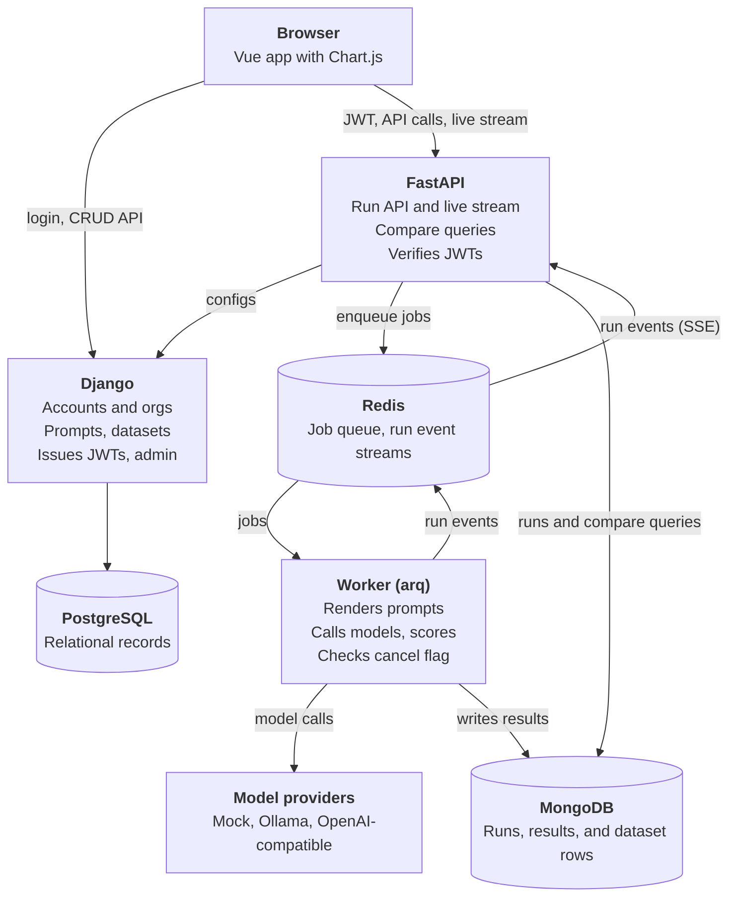
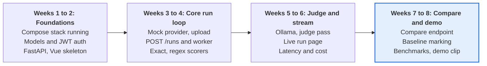

# LLM Evaluation Dashboard Spec

Source: "LLM Evaluation Dashboard Spec", Oct 23, 2026, @Jordan. Converted to Markdown; diagrams redrawn in Mermaid. Decisions made after conversion are folded into the relevant sections and summarized in [Decisions log](#decisions-log). Unresolved items are in [Open questions](#open-questions).

## Overview

The dashboard lets a developer run one dataset through several prompt versions and models, then see which combination wins on quality, latency, and cost.

The target user is an engineer tuning prompts for an LLM feature who today compares outputs by eye in a notebook. The core loop is: write a prompt version, pick a dataset and models, launch a run, watch results stream in, compare against the last version, and catch regressions before shipping.

Each technology has one clear job:

- **Django** owns accounts, projects, prompts, and the admin, because that data is relational and changes slowly.
- **FastAPI** owns the async work of calling model APIs and streaming progress.
- **MongoDB** owns run output, because every eval produces documents with different shapes.

Version one is built to run locally on free software, with local models by default.

## Goals and non-goals

Version one is done when a user can launch a run and compare it with the previous one without leaving the dashboard.

### Goals

- Store prompt templates with immutable versions and `{{variables}}`
- Upload datasets as JSONL, each row an input plus an optional expected output
- Run a prompt version over a dataset on one or more models, with live progress
- Score with exact match, contains or regex, and an LLM judge rubric, plus latency, token, and cost metrics
- Compare two runs side by side and flag rows that got worse
- Run entirely on local hardware with free software, using local models by default

### Non-goals for v1

- Fine-tuning or hosting models
- Human labeling queues
- Billing, quotas, or multi-region scale
- Hosted deployment for v1 (a read-only demo is a stretch goal)
- Support for every model provider (start with a mock provider and local Ollama)

## Architecture

Three services (Django, FastAPI, worker) and three stores (PostgreSQL, Redis, MongoDB). Django hands the browser a token, FastAPI verifies it and queues the work through Redis, and the worker writes every result to MongoDB, which FastAPI then reads back for the dashboard.



The browser arrows are logical: in practice all browser traffic goes through one same-origin proxy (see [Frontend stack](#frontend-stack)).

## Django data model

Django holds the slow-changing relational records in PostgreSQL. Runs and results never live there. It exposes the records to the Vue app through Django REST framework, and Django admin covers users and organizations.

| Model | Key fields | Notes |
| --- | --- | --- |
| `Organization` | `name`, `slug` | Tenant boundary for everything below |
| `Membership` | `user`, `organization`, `role` | Roles are `owner`, `editor`, `viewer`. `(user, organization)` is unique |
| `Project` | `organization`, `name`, `description`, `baseline_run_id` | Groups prompts, datasets, and runs. `baseline_run_id` is a nullable 24-character string holding a MongoDB run `ObjectId` in hex, set by "mark as baseline" (see [Dashboard views](#dashboard-views)) |
| `PromptTemplate` | `project`, `name` | Stable name that versions hang from |
| `PromptVersion` | `template`, `number`, `system_message`, `body`, `variables` | Immutable; an edit creates the next version |
| `Dataset` | `project`, `name`, `row_count` | Metadata here, rows in MongoDB. `row_count` is read-only through the normal create and update API (see [`dataset_rows`](#dataset_rows)) |
| `ProviderConfig` | `organization`, `name`, `kind`, `base_url`, `api_key_env`, `max_concurrency`, `requests_per_minute` | Kind is `mock`, `ollama`, or `openai_compatible`; local Ollama uses concurrency 1. `base_url` is required for `ollama` and `openai_compatible` and blank for `mock`. `api_key_env` is the *name* of an environment variable holding the key (blank for none); the key itself is never stored in the database |
| `ModelConfig` | `provider`, `model_name`, `temperature`, `max_tokens`, `context_length`, `input_price_per_1k`, `output_price_per_1k` | Prices are zero for local models and drive the cost metric for hosted ones. `context_length` is the context window the server is configured with (see [Context length](#context-length)) |
| `ScorerConfig` | `project`, `name`, `kind`, `params` | Kind is `exact`, `contains`, `regex`, or `llm_judge`. `params` is validated per kind (see below) |

There is no Django table for runs. Every run document in MongoDB stores the Django ids it depends on (organization, project, prompt version, dataset, model configs) as plain integers, and FastAPI fetches them from Django when a run is created, rejecting the run if any is missing. The tradeoff is that Django admin cannot list runs, so add a read-only admin view that queries MongoDB if you want one.

FastAPI fetches these records by calling Django REST framework endpoints with the caller's own JWT, so Django applies the same organization scoping and no service-to-service secret is needed.

Users are a custom user model (subclass of `AbstractUser`) from the first migration. Organizations are created through Django admin or `seed_dev` only; the API lets members read their organizations and owners update them. Members can read their organization's memberships; owners add memberships for existing users, change roles, and remove memberships through the API. Any change that would leave an organization with no `owner` membership (removing or demoting the last owner) is rejected with 400. Django admin enforces the same rule: demoting the last owner fails form validation, and deleting the last owner's membership (singly or in bulk) or deleting a user who is an organization's only owner is shown as protected on the delete confirmation page. Deleting the organization itself still removes its memberships. Deactivating the only owner (`is_active=False`) is allowed, and direct ORM or shell deletes are not guarded.

`ScorerConfig.params` is validated per kind, and unknown keys are rejected:

- `exact`, `contains`, `regex`: `{}`. The expected substring or regex pattern comes from each dataset row's `expected` value, not from params.
- `llm_judge`: `{"rubric": str, "judge_prompt": str, "judge_model_config_id": int}`, all required. `judge_prompt` pins the judge prompt in the config; `judge_model_config_id` must reference a `ModelConfig` whose provider belongs to the scorer's organization.

Prompt versions are immutable once created. Every persisted `PromptVersion` field is set at creation and never changes through any supported write path: the API is create and read only, admin presents saved versions as view-only (a new version is created through the normal create path), and model `save`/`delete` plus queryset `update`, `bulk_update`, and `delete` reject changes to existing rows. `PromptVersion.template` uses `on_delete=PROTECT`, so deleting a template, project, or organization cannot cascade away saved versions. This policy covers the ORM, admin, and API paths; it does not require a database trigger and makes no claim about raw SQL.

Creating a version assigns `number` as the template's highest number plus one on the server. Number allocation is serialized with `transaction.atomic` and a lock on the parent template row before the max-plus-one read, and `(template, number)` remains unique at the database level, so concurrent creates cannot collide. `PromptVersion.variables` is derived at creation from `{{name}}` placeholders in `system_message` and `body`; it is not user-entered.

Writes validate tenant consistency: every object a record references (a dataset's project, a model config's provider, a scorer's judge model) must belong to the same organization as the record, and the caller must be an `editor` or `owner` there.

Through the API, rows in organizations the caller does not belong to return 404, and a referenced id outside the caller's organizations is rejected with 400 as nonexistent. Role checks read current memberships, not token claims. Deleting a record that protected rows still depend on (for example, a template with saved versions) returns 409.

Tenant moves are forbidden. An existing record can never change organizations, directly or through reparenting: a `Project`'s `organization` never changes, a `ModelConfig` cannot be repointed to another organization's `ProviderConfig`, and no other update may make a record or one of its references cross a tenant boundary. This holds on every supported write path (API and admin alike); cross-tenant transfers are unsupported. Same-organization edits remain allowed, with the reference-consistency validation above re-applied on save.

## MongoDB collections

Three collections hold everything a run produces, and each scored output is its own document so a run can grow large without nearing the 16 MB document limit.

### `runs`

One document per run, with a snapshot of the prompt, model, and scorer settings it used (including each model's exact tag, digest where the provider reports one, and `context_length`; an `llm_judge` scorer's snapshot includes its judge model's full config the same way, so a judge pass is reproducible) and a summary that the worker recomputes when the run finishes. FastAPI builds the snapshot at `POST /runs` and freezes it; the worker only reads it, so edits to prompt, provider, model, or scorer configs after creation never change what a stored run recorded. Tests must verify this by editing mutable provider/model/scorer configuration and creating a new prompt version after run creation, then confirming the stored snapshot is unchanged. `organization_id` is stored so FastAPI can authorize every run, result, and compare request from the token alone, without calling Django.

```json
{
  "_id": "ObjectId",
  "organization_id": 4,
  "project_id": 12,
  "prompt_version_id": 31,
  "dataset_id": 7,
  "model_config_ids": [2, 5],
  "scorer_ids": [1, 4],
  "snapshot": { "prompt": "...", "models": [], "scorers": [] },
  "status": "running",
  "created_by": 3,
  "created_at": "2026-10-23T21:30:00Z",
  "finished_at": null,
  "totals": { "rows": 200, "done": 87, "failed": 1 },
  "summary": {
    "2": {
      "mean_score": 0.81,
      "by_scorer": { "1": 0.9, "4": 0.72 },
      "p95_latency_ms": 2100,
      "cost_usd": 0.42,
      "error_count": 1
    }
  }
}
```

`status` is one of `queued`, `running`, `finished`, `failed`, `cancelled`. `summary` is keyed by model config id, and each entry holds:

- `mean_score`: mean of all 0 to 1 scorer values for that model
- `by_scorer`: mean score per scorer id
- `p95_latency_ms`, `cost_usd`, `error_count`

### `results`

One document per dataset row per model. This is the collection the dashboard reads most.

```json
{
  "_id": "ObjectId",
  "run_id": "ObjectId",
  "row_index": 41,
  "model_config_id": 2,
  "input": { "question": "..." },
  "expected": "...",
  "rendered_prompt": "...",
  "output": "...",
  "usage": { "input_tokens": 312, "output_tokens": 88 },
  "latency_ms": 912,
  "cost_usd": 0.0021,
  "error": null,
  "context_limited": false,
  "scores": [
    { "scorer_id": 1, "value": 1.0, "reason": null },
    { "scorer_id": 4, "value": 0.5, "reason": "Missing the second required step" }
  ]
}
```

### `dataset_rows`

The uploaded JSONL, one document per row, keyed by `dataset_id` and `row_index`.

Each JSONL line must be an object of this shape:

```json
{ "input": { "question": "What is the capital of France?" }, "expected": "Paris" }
```

- `input` (required): an object whose keys fill the prompt's `{{variables}}`. Values are strings, numbers, or booleans.
- `expected` (optional): a string used by the `exact`, `contains`, and `regex` scorers.
- Any other top-level key, a non-object line, or a missing `input` rejects the upload with the offending line numbers.
- Whether `input` covers a prompt version's variables is checked at `POST /runs`, since datasets and prompts are created independently. Missing variables reject the run.

Each stored document holds `dataset_id`, `row_index` (0-based line order), `input`, and `expected`.

Datasets are immutable once rows are uploaded, because compare joins runs by `row_index`. A second upload to the same dataset returns 409 (dataset versions remain a stretch goal). `Dataset.row_count` stays null until an upload succeeds; FastAPI then sets it through a DRF endpoint using the caller's JWT, so Django remains the only writer of relational records. `row_count` is read-only in the normal dataset create and update API. A dedicated set-row-count action (added with upload in Phase 2, editor role required) sets it only while it is null and returns 409 once it is set.

### Indexes

| Collection | Index | Why |
| --- | --- | --- |
| `runs` | `project_id`, `created_at` descending | Run history list per project |
| `results` | `run_id`, `model_config_id`, `row_index` (unique) | Stream and page one run, and join two runs by row |
| `results` | `run_id`, `scores.value` | Sort a run worst-first to inspect failures |
| `dataset_rows` | `dataset_id`, `row_index` (unique) | Read a dataset in order |

## FastAPI endpoints

FastAPI serves the work that is async or high volume, and only `POST /runs` creates a queued evaluation run.

All FastAPI routes below are mounted under `/api/eval` (for example `POST /api/eval/runs`), and all Django REST framework routes under `/api/records`. Each service owns its prefix, so the proxy (see [Frontend stack](#frontend-stack)) forwards paths unchanged. Django and FastAPI also each have an unprefixed `GET /health` that the proxy does not expose. Django admin is mounted at `/api/records/admin/` so it is reachable through the proxy.

| Method and path | Purpose |
| --- | --- |
| `POST /runs` | Validate the Django ids, build the frozen snapshot, write the run document, enqueue the job, return the run id |
| `GET /runs?project_id=` | Run history for a project, newest first, cursor-paginated (uses the `runs` index) |
| `GET /runs/{id}` | Run document with totals and summary |
| `GET /runs/{id}/stream` | Server-Sent Events: progress counts and each result as it completes, read from the run's Redis Stream; honors `Last-Event-ID` to resume while history is retained, and answers lost history with a `reset` event (see [Run lifecycle and scoring](#run-lifecycle-and-scoring)) |
| `GET /runs/{id}/results` | Paginated results, filterable by model, scorer, maximum score, or errors only |
| `POST /runs/{id}/cancel` | Stop a running job and keep the partial results. A still-`queued` run is marked `cancelled` immediately, and the worker skips it when its job starts |
| `GET /compare?base=&candidate=` | Join two runs by row and model, return per-row score change and aggregate change, flag regressions |
| `POST /datasets/{id}/rows` | Streamed JSONL upload, validated and bulk inserted into `dataset_rows` |
| `GET /datasets/{id}/rows` | Paginated rows in `row_index` order, for the dataset preview |
| `POST /playground` | Render one prompt against one model and stream tokens, for quick tries before a full run |

The compare endpoint is the interesting query. It uses an aggregation pipeline that matches both run ids, groups by `row_index` and `model_config_id`, collects each run's scores into one document, and projects the difference. A row counts as a regression when the candidate score drops below the base score by more than a threshold the caller can set, defaulting to `0.1`.

Compare rules:

- Both runs must share `dataset_id`; otherwise the endpoint returns 400.
- Results are matched on `row_index`, `model_config_id`, and `scorer_id`.
- A row is a regression if any scorer drops by more than the threshold, or if the candidate errored where the base succeeded.
- Rows or models present in only one run are reported as unmatched, not as regressions.

Dataset endpoints authorize by fetching the dataset from Django with the caller's JWT, which confirms the dataset exists and belongs to an organization the caller can access. FastAPI reaches Django at the URL in its `RECORDS_BASE_URL` environment variable (`http://localhost:8000` natively, the Compose service name in the `app` profile), not through the browser-facing proxy.

Every endpoint except `GET /health` expects a JWT issued by Django, sent in the `Authorization` header. That includes the stream, which is why the Vue app reads it with `fetch` instead of the native `EventSource`, which cannot set headers. Pydantic models validate request bodies, and the same models define the response shapes the dashboard consumes.

## Run lifecycle and scoring

A run moves through six steps, and the unique index on `results` makes any step safe to retry.

1. `POST /runs` validates the ids against Django, builds a frozen snapshot of the prompt version, model, and scorer settings (including each judge model's full config, `context_length`, and provider-reported tag and digest fetched through the shared `evalcore` provider metadata client), writes the run document as `queued`, and enqueues a job.
2. The worker loads the snapshot and the dataset rows from MongoDB, then renders each row into a prompt by filling its variables. The worker only reads the snapshot; it never consults live Django config and never builds or modifies it.
3. The worker generates outputs one model at a time, so a single GPU never swaps models mid-run. Each provider has its own concurrency limit (1 for local Ollama) and a requests-per-minute limiter, and calls retry with backoff on rate limits.
4. Each finished generation is saved as a result document and pushed to the stream, with the rule-based scorers (`exact`, `contains`, `regex`) applied immediately.
5. After generation, the judge runs as a second pass over the saved outputs, one judge model at a time, and each score is added to its result and pushed to the stream.
6. When all passes finish, the worker recomputes the summary with a `$group` over results and marks the run `finished`, `failed`, or `cancelled`.

Lifecycle rules:

- **Event delivery:** "pushed to the stream" means the worker appends an event to a Redis Stream per run (`run:{id}:events`), length-capped and set to expire after the run reaches a final status. FastAPI reads that stream for `GET /runs/{id}/stream` and uses each stream entry id as the SSE event id, so a reconnecting client sends `Last-Event-ID` and resumes without gaps while that history is retained. The stream is notification history only: the MongoDB `runs` and `results` documents are authoritative, and nothing claims the MongoDB write plus Redis publish is exactly-once. (MongoDB change streams were rejected because they require a replica set.)
- **Stream reset:** when the requested history is unavailable — the `Last-Event-ID` cursor was trimmed or expired, or it points ahead of the stream's entries — FastAPI sends one SSE event named `reset` (with no SSE id) whose data carries a `resume_from` cursor, then closes the stream. `resume_from` is the stream's current end, captured at reset time before the client refetches, so events published during the resync gap are not skipped; on an empty stream it is the sentinel `0-0`. The client refetches the authoritative run and results through the authenticated run and results API endpoints (the MongoDB documents remain authoritative; the browser never accesses the database directly), reconnects with `Last-Event-ID` set to `resume_from`, and applies replayed events idempotently. If history is lost again it repeats the reset, except that it does not reset repeatedly on the `0-0` sentinel while the stream stays empty, and it stops reconnecting once the refetched run has reached a terminal status. FastAPI performs the same history-loss check before each batch it delivers on an established stream, not only at connect time. Reset handling is verified by reconnect tests after history trim and expiry, by a client that stops cleanly when the refetched run is terminal, and by events published during the resync gap still being delivered after reconnect.
- **One run at a time:** the worker processes one run job at a time (arq `max_jobs=1`) so two runs never load different models onto the GPU together; additional runs wait as `queued`. The playground calls providers directly from FastAPI and may briefly force a model swap during a run; this is accepted for v1.
- **Rendering:** plain `{{name}}` substitution (whitespace inside the braces allowed) in both `system_message` and `body`, with no logic, filters, or escaping. A missing variable is an error, never an empty string.
- **Crash recovery:** arq retries the job, and a retried job skips rows that already have a result for that model (the unique index makes this safe). On worker startup, a run left `running` whose arq job is neither queued nor in progress is marked `failed`; runs with a pending retry are left alone.
- **Errors:** a generation error is stored on the result's `error` field, counted in `totals.failed`, and excluded from score means.
- **Unparseable judge output:** if the judge's reply is not valid JSON, the score is stored as `value: null` with the raw text as `reason`, and is excluded from means.

The four scorer kinds (`exact`, `contains`, `regex`, `llm_judge`) produce values from 0 to 1. Latency, token usage, and cost are separate measurements, not scores.

| Scorer | How it works | Output |
| --- | --- | --- |
| `exact` | Normalized string equality with the expected output | 0 or 1 |
| `contains` or `regex` | Expected substring or pattern found in the output | 0 or 1 |
| `llm_judge` | A judge model grades the output against the rubric in the scorer params | 0 to 1 plus a one-line reason |
| latency, tokens, cost | Recorded from the call, with cost computed from the model's per-token prices | Numbers, not scores |

For the judge, use temperature 0, pin the judge prompt in the scorer config, and prefer a different model from the one being tested so a model does not grade its own style. Small local judges are noisy, so use rule-based scorers wherever the task allows and ask the judge for a JSON score against a short rubric. Always store the judge's reason, because it is what makes a low score debuggable.

## Model providers

Version one has three kinds of provider behind one interface. Ollama and OpenAI-compatible providers speak the OpenAI-compatible API, so each is just a base URL, a model name, and limits. The mock is an in-process client in `evalcore` implementing the same interface: canned or echoed outputs, configurable latency and token counts, and a seed so test runs are deterministic. It needs no `base_url`.

| Provider | Cost | Use it for |
| --- | --- | --- |
| Mock | Free, unlimited | Tests, demos, and throughput benchmarks, with canned outputs and configurable latency |
| Ollama, local | Free, unlimited, needs hardware | Real evals, with model tags pinned |
| Free hosted tiers (Gemini, OpenRouter free models) | Free, with request caps | A few multi-provider comparisons |

### Hardware

- **Desktop (model machine):** GTX 1080, 8 GB VRAM. Models of 7 to 9B parameters at Q4 fit, such as Llama 3.1 8B, Qwen 2.5 7B, Mistral 7B, and Llama 3.2 3B, while 14B models spill onto the CPU and run slowly. Run one model at a time, keep the context length at 4 to 8K, and confirm with `ollama ps` that the model reports 100% GPU.
- **Laptop (development only):** no discrete GPU. Code, run the stack, and run tests against the mock provider. The laptop never runs real evals or connects to the desktop's Ollama; code moves between machines through the git remote.

A good first comparison is Llama 3.2 3B against Llama 3.1 8B as the models under test, with Qwen 2.5 7B as the judge. Use a small Q&A dataset with expected answers for the rule-based scorers, plus one rubric-graded task for the judge.

Free hosted tiers cap requests per minute and per day, and the caps change often, so each provider config carries a requests-per-minute limit that the worker honors. Hosted free models also rotate, so the run snapshot records the exact model tag and digest.

### Ollama setup

- **Run Ollama natively on the GPU machine, not in Docker.** GPU access is simpler and model memory stays outside the Docker VM.
- **Network access:** keep Ollama on its default `127.0.0.1` binding. That is enough for native services and (on Docker Desktop) containers using `host.docker.internal`. Nothing in v1 needs Ollama reachable from another machine, so do not open it to the network.
- **GTX 1080 support:** Ollama supports compute capability 6.1 cards, but they require NVIDIA driver 570 or newer and run on Ollama's CUDA 12 runner (CUDA 13 dropped Pascal). At least one Windows release has regressed Pascal support, so disable Ollama auto-update, pin a version that works, and record it in `AGENTS.md`.
- **Digests:** the OpenAI-compatible `/v1/models` endpoint does not return digests. For `ollama` providers the API reads the tag digest from Ollama's native `/api/tags` (or `/api/show`) through the shared `evalcore` provider metadata client when it builds the run snapshot at `POST /runs`. If the metadata request fails, run creation is rejected with 502 and no run is persisted or enqueued; a configured model missing from the provider's response is a 400. Providers that do not expose a digest (mock, generic `openai_compatible`) snapshot `null` explicitly — a digest is never invented. Tests must cover metadata failure and a missing configured model, asserting that neither a run nor a queued job is created.

### Context length

Ollama's OpenAI-compatible endpoint cannot set the context size per request, and prompts longer than the server's context are truncated without an error, which would silently corrupt eval results.

- Configure the context on the Ollama server: `OLLAMA_CONTEXT_LENGTH=8192` in the server environment, or a Modelfile with `PARAMETER num_ctx 8192` and the derived model name in `ModelConfig.model_name`.
- Set `ModelConfig.context_length` to the same value. The API copies it into the run snapshot at creation.
- The worker sets `context_limited: true` on any result whose `usage.input_tokens + usage.output_tokens` reaches `context_length`, and the dashboard shows those rows with a warning.

### Remote and cloud GPU machines

A stronger machine later (for example a rented cloud GPU) is just another provider: an `openai_compatible` or `ollama` provider whose `base_url` points at Ollama, vLLM, or the llama.cpp server on that machine. Hosted keys are read from the variable named in `api_key_env`.

Ollama has no authentication. Never expose port 11434 to the internet; reach remote machines over a private network such as Tailscale (free for personal use) or behind a reverse proxy that enforces auth. The "one model at a time" rule exists for a single consumer GPU and can be relaxed per provider later if a larger machine warrants it.

## Dashboard views

The dashboard has six screens, and the compare page is the one that earns the project its place in a portfolio.

- **Run history:** a table per project with status, mean score, p95 latency, cost, and date
- **Prompt editor:** versions on the left, a diff against the previous version, and detected variables
- **Datasets:** JSONL upload with a preview of the first rows
- **New run:** pick a prompt version, a dataset, one or more models, and the scorers
- **Live run:** a progress bar, a rolling mean score per model, and a results table that fills in as results stream
- **Compare:** choose a base and a candidate run, see score, latency, and cost change per model and scorer, then open any regressed row to read both outputs and the judge's reasons side by side

Two interactions tie the screens together:

- **Mark as baseline** on a run stores its id on the project (`Project.baseline_run_id`), and the compare page defaults to that baseline.
- **Rerun with new version** on a run opens the new run form pre-filled with the same dataset, models, and scorers.

### Frontend stack

Build the UI as a Vue 3 single-page app with Vite and TypeScript, using Vue Router, Pinia, TanStack Query and TanStack Table for Vue, and Chart.js for charts. Generate typed API clients from the OpenAPI schemas of FastAPI and Django REST framework with `openapi-typescript`, and call them with `openapi-fetch`. The schemas are exported without running the servers (`manage.py spectacular --file` for Django, a script that dumps `app.openapi()` for FastAPI), the generated types are committed under `web/src/api/generated/`, and CI regenerates them and fails if they differ. The browser reads the run stream with a fetch-based reader that sends the JWT in the `Authorization` header.

**Same-origin proxy.** The browser only talks to one origin, so neither service needs CORS and the refresh cookie can be `SameSite=Strict`. In development the Vite dev server proxies `/api/records` to Django and `/api/eval` to FastAPI. In the Compose `app` profile a Caddy container serves the built SPA and proxies the same paths, with response buffering disabled (`flush_interval -1`) so SSE events arrive immediately.

## Auth, jobs, and deployment

Django is the only service that signs tokens, and everything else only verifies them.

**Auth.** Django issues short-lived JWTs with `djangorestframework-simplejwt`, signed with RS256. The token carries the user id and a map of organization ids to roles. JSON object keys are always strings, so verifiers (the `evalcore` claims model) convert the map's keys to integers before comparing them with `organization_id`. FastAPI holds only the public key, so it can verify tokens but never mint one. A FastAPI dependency checks the role per route: viewers read, editors create and cancel runs, and owners can do everything editors can plus manage memberships and organization settings. The Vue app keeps the access token in memory and keeps a refresh token in an httpOnly cookie. `simplejwt` returns refresh tokens in the response body by default, so Django needs custom obtain, refresh, and logout views that set, read, and clear the cookie.

- **Lifetimes:** access token 5 minutes; refresh token 7 days, rotated on each refresh. Role changes take effect at the next refresh: by default `simplejwt` copies custom claims from the old refresh token, so the custom refresh view rebuilds the role map from current memberships instead.
- **Revocation:** `simplejwt`'s `token_blacklist` app is enabled with `BLACKLIST_AFTER_ROTATION`, so a rotated refresh token cannot be reused, and logout blacklists the cookie's refresh token before clearing it.
- **Stream lifetime:** the SSE stream is authorized at connect time only, so a long run's stream can outlive its access token.
- **Cookie flags:** `HttpOnly`, `SameSite=Strict`, `Secure` controlled by an environment variable (on by default; browsers accept `Secure` cookies on `http://localhost`, so turn it off only if the app is ever served over plain HTTP on another hostname), and `Path` scoped to the Django auth endpoints so the cookie is never sent to FastAPI. The refresh endpoint also requires a custom request header as cross-site request forgery protection.
- **DRF authentication:** API views authenticate with JWT only (no `SessionAuthentication`), so Django's session CSRF rules apply only to Django admin.
- **Bearer validation:** the shared `evalcore` verifier requires RS256 signature verification with the public key, a present and unexpired `exp`, a valid `user_id`, the organization-role map, and `token_type` exactly `access`; a refresh token or a missing token type is rejected even when correctly signed. DRF bearer authentication accepts access tokens only. FastAPI returns 401 for missing or invalid bearer credentials and 403 for a valid access token without the required organization role; DRF object lookup remains scoped to the caller's organizations.
- **Accounts:** no public signup in v1. A `seed_dev` management command creates a superuser, an organization with an owner membership, a project, and a mock provider and model. It reads the superuser's username and password from `DEV_SUPERUSER_USERNAME` and `DEV_SUPERUSER_PASSWORD` (placeholders in `.env.example`), refuses to run if the password is unset, and is safe to run twice. Further users are added through Django admin.

**Background jobs.** Use arq with Redis. Runs are I/O-bound calls to model APIs, so an async worker fits better than Celery's process pool. Cancellation is a flag in Redis that the worker checks between rows. (Celery would also work, at the cost of running sync workers beside async code.) arq is in maintenance-only mode upstream: it still receives fixes and supports Python 3.13, but no new features. Pin its version and keep enqueueing behind one small function in `evalcore` so the queue can be swapped later without touching the API or run logic.

**Deployment.** Version one runs locally. Docker Compose defines the services (Django, FastAPI, the worker, PostgreSQL, MongoDB, and Redis) so the whole stack starts with one command, and the Vue app runs from the Vite dev server or as static files. Postgres and MongoDB run as containers, so there are no accounts, storage caps, or idle pauses.

Develop on either machine; run real evals only on the desktop. Both machines run the same dev setup (Docker Desktop for the stores, `uv`, Node), and the laptop uses only the mock provider. Ollama runs on the desktop alongside the app, so its provider base URL is always local. Keys for any hosted provider live in environment variables.

**Development workflow on Windows.** Bind-mounting Windows source into Linux containers is slow and file-watch reloads are unreliable. During development, Compose runs only PostgreSQL, MongoDB, and Redis; Django, FastAPI, and the worker run natively with `uv`, and the Vue app with the Vite dev server. The app services, plus a Caddy container that serves the built SPA and proxies the APIs, are also defined in Compose behind an `app` profile (`docker compose --profile app up`) for one-command full-stack runs. Provider base URLs differ by where the worker runs: `http://localhost:11434` natively, `http://host.docker.internal:11434` from a container.

**`app` profile containers.**

- `records`, `api`, and `worker` each have a Dockerfile in their service directory, built with the repository root as context so the uv workspace and lockfile are available.
- The `records` container runs `migrate`, then serves Django's ASGI app with uvicorn (the same server FastAPI uses, so no extra dependency). It serves Django admin at `/api/records/admin/` and admin static files under `/api/records/static/` with WhiteNoise, so admin works through the proxy; `CSRF_TRUSTED_ORIGINS` comes from an environment variable listing the browser-facing origins (`http://localhost:5173` for Vite, `http://localhost:8080` for Caddy).
- `proxy/Dockerfile` is multi-stage: a Node stage builds `web/`, and the Caddy stage serves `dist/`. Caddy listens on plain HTTP (a `:80` site address, published as `http://localhost:8080`), so it never attempts automatic HTTPS.
- The JWT keys are mounted read-only: `records` gets both the private key (signing) and the public key (simplejwt's RS256 `VERIFYING_KEY`, needed to authenticate access tokens on DRF requests); `api` and `worker` get only the public key. The private key is never mounted anywhere but `records`.
- The `worker` healthcheck is arq's built-in Redis health check (`arq --check`); it serves no HTTP.

**Memory budget (16 GB host).** The stack must leave room for Ollama, an IDE, and a browser:

- Cap the Docker Desktop VM at about 6 GB in `%UserProfile%\.wslconfig`.
- Start MongoDB with `--wiredTigerCacheSizeGB 0.5`; by default it claims about half the memory it can see.
- Set memory limits on every Compose service.
- Publish the store ports (PostgreSQL, MongoDB, Redis) for native services bound to `127.0.0.1` only, never `0.0.0.0`, so dev databases with placeholder credentials are not reachable from the LAN.
- Keep Ollama outside Docker (see [Ollama setup](#ollama-setup)).

**Observability.** Django and FastAPI each expose a `/health` route (the worker uses arq's health check instead, since it serves no HTTP), and every log line carries a run id so one run can be traced across the API and the worker.

## Milestones

Eight weeks in four phases: run loop first, compare and demo last. The plan assumes about two weeks per phase. Compare lands last because it needs a working run loop and a judge scorer to be worth looking at.

Phase 1 (Foundations) scope note: the provider, model, and scorer *configuration* records — `ProviderConfig`, `ModelConfig`, and `ScorerConfig` models, admin, API, validation, and the `seed_dev` mock records — are built in Phase 1. The mock provider client and rule-based scoring arrive with the run loop in Phase 2; Ollama and judge scoring follow in Phase 3.



## Stretch goals

- Provider API keys stored encrypted per organization
- A hosted read-only demo on free tiers (for example Neon for Postgres and Atlas for MongoDB), fed by the mock provider
- A regression gate: a CLI or GitHub Action that fails a pull request when a prompt version scores below the baseline
- Pairwise judging, where the judge picks the better of two outputs instead of scoring one
- Dataset versions and sampled subsets for quick runs
- CSV export of a run

## Portfolio metrics to capture

Concrete numbers make this read as engineering rather than a tutorial. Measure and report:

- Dataset rows ingested per second on upload
- Rows scored per minute per provider, with the mock provider showing the stack's ceiling and Ollama showing real model speed
- Time for the compare endpoint to answer on two runs of 10,000 and of 100,000 results
- Cost per run as the dashboard computes it (zero for local models), checked against a hosted provider's usage page when one is used
- p95 latency of the results endpoint with the indexes in place and without them

## Decisions log

Resolved after conversion from the source document. Each is written into the relevant section above; this list is the index.

1. **Run summary:** the worker recomputes it (the source said both FastAPI and the worker).
2. **Owner role:** everything an editor can do, plus manage memberships and organization settings.
3. **Tenant checks on Mongo data:** run documents store `organization_id`, so FastAPI authorizes from the token alone.
4. **Config fetch:** FastAPI calls Django REST framework with the caller's JWT; no service-to-service secret.
5. **Refresh token:** httpOnly cookie set, read, and cleared by custom Django views.
6. **Dataset row shape:** `{"input": {...}, "expected": "..."}` per JSONL line, strict validation (see [`dataset_rows`](#dataset_rows)).
7. **Local hardware:** Ollama runs natively; context length is configured server-side and recorded per model; Compose runs only the stores during development, with memory caps (see [Model providers](#model-providers) and [Auth, jobs, and deployment](#auth-jobs-and-deployment)).
8. **Hosted and remote providers:** API keys are referenced by environment variable name (`ProviderConfig.api_key_env`); remote Ollama is reached only over a private network.
9. **Accounts:** no public signup; `seed_dev` bootstraps a local org, and admin adds users.
10. **Tokens:** access 5 minutes, refresh 7 days with rotation; cookie is `HttpOnly`, `SameSite=Strict`, `Secure` by environment, and refresh requires a custom header.
11. **Datasets are immutable** after upload; `row_count` is set by FastAPI through DRF.
12. **Rendering:** plain `{{name}}` substitution; missing variables are errors.
13. **Crash recovery:** retried jobs skip finished rows; orphaned `running` runs are marked `failed` on worker startup.
14. **Errors and judge parse failures** are stored and excluded from score means.
15. **Summary shape:** `mean_score`, `by_scorer`, `p95_latency_ms`, `cost_usd`, `error_count` per model.
16. **Compare:** same dataset required; matched on row, model, and scorer; any scorer drop or new error is a regression; one-sided rows are unmatched.
17. **Same-origin proxy:** Vite in development, Caddy in the `app` profile; `/api/records` to Django, `/api/eval` to FastAPI; no CORS.
18. **API clients:** `openapi-typescript` with `openapi-fetch`.
19. **Added endpoints:** `GET /runs?project_id=` (run history) and `GET /datasets/{id}/rows` (dataset preview), which the source's screens required but did not list.
20. **Auth hardening:** refresh cookie `Path` scoped to Django auth endpoints; DRF uses JWT authentication only.
21. **arq** stays despite maintenance-only status, pinned and wrapped behind one enqueue function.
22. **Mock provider:** in-process client in `evalcore`, deterministic via a seed; `base_url` blank for `mock`.
23. **One run at a time:** worker `max_jobs=1`; playground model swaps accepted for v1.
24. **Judge snapshot:** `llm_judge` scorers snapshot their judge model's full config. FastAPI builds the frozen snapshot at `POST /runs`; the worker only reads it.
25. **Run events:** Redis Stream per run, SSE event id is the stream entry id, resumable with `Last-Event-ID` while history is retained; trimmed or expired history is answered with a `reset` event and the client refetches authoritative state through the run/results APIs.
26. **Fresh role claims:** the refresh view rebuilds the `{org_id: role}` map from the database; verifiers convert its string keys to integers.
27. **Refresh revocation:** `token_blacklist` with `BLACKLIST_AFTER_ROTATION`; logout blacklists the refresh token.
28. **Write-side tenant checks:** referenced objects must belong to the same organization; `(template, number)` is unique on `PromptVersion`.
29. **Worker health:** arq's Redis health check, not an HTTP route; only Django and FastAPI expose `/health`.
30. **Generated API types:** schemas exported without servers, types committed, CI fails on drift.
31. **`app` profile:** per-service Dockerfiles built from the repo root, `migrate` on `records` start, admin and WhiteNoise static under `/api/records/`, multi-stage Caddy image on plain HTTP.
32. **Dev accounts:** `seed_dev` takes superuser credentials from environment variables.
33. **Users and organizations:** custom user model from the first migration; organizations created only in admin or `seed_dev`; owners update their organization and manage memberships through the API.
34. **Prompt version API:** create and read only; the server assigns the next `number`.
35. **Ports:** Vite on `5173`, Caddy published on `8080`, Django `8000` and FastAPI `8001` natively (the same ports inside the `app` profile containers); store ports are published on `127.0.0.1` only.
36. **Scorer params:** validated per kind; rule-based scorers take `{}` and read `expected`; `llm_judge` requires `rubric`, `judge_prompt`, and a same-organization `judge_model_config_id`.
37. **Memberships:** `(user, organization)` unique; owners add, re-role, and remove memberships; the last owner cannot be removed or demoted through the API or Django admin, including by deleting the user.
38. **Dataset `row_count`:** read-only in the normal API; a dedicated Phase 2 action sets it once while null, 409 afterwards.
39. **`baseline_run_id`:** nullable 24-character string holding a run `ObjectId` in hex.
40. **JWT key mounts:** `records` holds the private and public keys; `api` and `worker` hold only the public key.
41. **No tenant moves:** existing records cannot change organizations, directly or through reparenting, on any API or admin write path; same-organization edits stay allowed with reference consistency revalidated.

## Open questions

None currently. Add new ones here with a suggested default and the phase they block.
